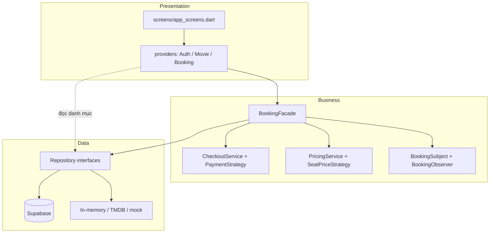

# Kiến trúc & mẫu thiết kế trong MOVIEGO

Mỗi mẫu trình bày theo 4 mục của slide: **Tên → Vấn đề → Giải pháp → Hệ quả**.
Chỉ ghi mẫu có thật trong code; mỗi mục ghi rõ file để giảng viên truy vết.

## Kiến trúc 3 tầng

- **Presentation**: `lib/views/` (View) + `lib/viewmodels/` (ViewModel, dùng `ChangeNotifier` của gói provider nên tên file là `*_provider.dart`).
- **Business** (`lib/business/`): `BookingFacade`, `CheckoutService`, `PricingService`. Không có lệnh Supabase.
- **Data** (`lib/db/`): các `*Repository`; chỉ tầng này dùng `DatabaseConfig.client`.
- Ngoại lệ có chủ ý: `MovieProvider`/`BookingProvider.loadCinemas` đọc danh mục (chỉ đọc, không có luật nghiệp vụ) qua interface Repository, không qua tầng Business. Luồng đặt vé thì luôn đi qua Facade.

## 1. Singleton — `AppConfig`, `DatabaseConfig`
- **Vấn đề**: URL/khóa Supabase, thời gian giữ ghế cần dùng chung, không được tạo nhiều bản.
- **Giải pháp**: `lib/core/config/app_config.dart` (factory constructor + instance tĩnh); `lib/db/supabase_client.dart` bọc `Supabase.instance` (vốn đã là singleton của thư viện).
- **Hệ quả**: truy cập tiện, nhưng khó mock. Giảm nhẹ: lớp nghiệp vụ nhận Repository qua constructor; chỉ `main.dart`/`app.dart` chạm vào singleton.

## 2. Repository (kèm DIP) — `lib/db/repositories/`
- **Vấn đề**: màn hình/nghiệp vụ gọi thẳng Supabase thì không đổi được nguồn dữ liệu và khó kiểm thử.
- **Giải pháp**: interface `MovieRepository`, `CinemaRepository`, `BookingRepository`, `AuthRepository`; bản hiện thực `Supabase*`, `InMemoryBookingRepository`, `StaticCinemaRepository`, `LocalAuthRepository`, `TmdbMovieRepository`. `app.dart` là nơi duy nhất chọn bản hiện thực.
- **Hệ quả**: chạy offline và test được bằng bản trong bộ nhớ; đổi lại có thêm nhiều file/interface.
- `FallbackMovieRepository` chỉ là lớp bọc "Supabase lỗi/rỗng thì dùng TMDB/mock", không gán nhãn mẫu GoF nào.

## 3. Strategy — thanh toán và giá vé
- **Vấn đề**: nhiều cách thanh toán và nhiều loại ghế, nếu dùng if-else thì mỗi lần thêm phải sửa code cũ.
- **Giải pháp**: `PaymentStrategy` (`EWalletPayment`, `CardPayment`, `CodPayment`) + context `CheckoutService` (`lib/business/payment/`); `SeatPriceStrategy` (`StandardSeatPrice`, `VipSeatPrice`) + `PricingService` (`lib/business/pricing/seat_pricing.dart`).
- **Hệ quả**: thêm hình thức mới = thêm 1 lớp (Open/Closed). Đổi lại: số lớp tăng; `PricingService` phải sắp strategy đặc biệt trước strategy mặc định.

## 4. Observer — thông báo vé và ghế thời gian thực
- **Vấn đề**: vé đổi trạng thái cần báo nhiều nơi; ghế phải cập nhật khi người khác đặt.
- **Giải pháp**: `BookingSubject`/`BookingObserver` (`InAppNotifier`, `EmailNotifier`) trong `lib/business/booking/`; ghế dùng `Stream` từ `watchTakenSeats` (Supabase Realtime) được `BookingProvider.openSeatMap` lắng nghe.
- **Hệ quả**: thêm kênh thông báo không sửa `BookingSubject`. Đổi lại: khó lần vết luồng chạy; phải hủy đăng ký (`closeSeatMap`) để không rò rỉ.

## 5. Facade — `BookingFacade.bookTicket()`
- **Vấn đề**: đặt vé gồm nhiều bước (kiểm tra ghế, giữ ghế, thanh toán, lưu vé, thông báo); để trong màn hình/Provider sẽ rối và khó test.
- **Giải pháp**: `lib/business/booking/booking_facade.dart` gom các bước theo đúng thứ tự, trả `BookingResult`.
- **Hệ quả**: Provider gọn, test độc lập (`test/business/booking_facade_test.dart`). Đổi lại: Facade dễ phình thành "God class" nếu nhét thêm nghiệp vụ.

## Chưa dùng (cố ý)
Factory Method, Decorator (combo chỉ là cộng danh sách), Adapter (chưa tích hợp MoMo/ZaloPay thật), Template Method.

## Giới hạn đã biết
- Thanh toán đang là mô phỏng. Nếu tích hợp cổng thật, cần bước hoàn tiền khi `confirm_booking` lỗi sau khi đã trừ tiền.
- `confirm_booking` nhận `p_total` từ client; bản production nên tính lại tổng tiền trong SQL.
- Bảng `reviews`, `favorites` đã có trong schema nhưng màn hình chưa nối.
